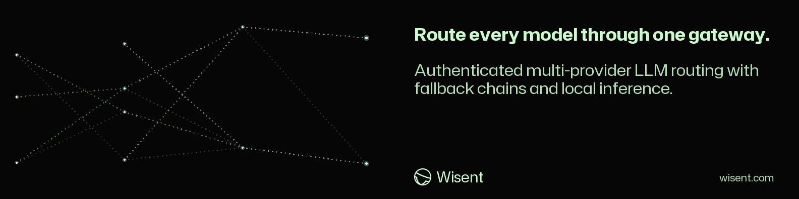

<!-- wisent-banner:start -->
<p align="center">
  
</p>
<!-- wisent-banner:end -->

<!-- wisent-readme-signals:start -->
[](https://github.com/wisent-ai/brama) [](https://github.com/wisent-ai/brama/issues) [](https://wisent.com) [](https://discord.gg/qRjpkthq54) [](https://www.linkedin.com/company/wisent-ai/) [](https://x.com/wisentai) [](https://calendly.com/lbartoszcze)
<!-- wisent-readme-signals:end -->

# Brama: Keep All Your Models Accessible Through One Endpoint

All Models and Providers United in One API.

Brama is the simplicity your stack needs. One API, one identity, uniting every
model you own in one API. When you switch from Claude-Cthulu to GPT-Bazillion or
cancel your subscription, you won’t have to update it everywhere. Define
heuristics such as best, fast, or cheap to call this endpoint with intelligent
routing. And every token is attributed, so you can audit where your subscription
and API money is going. Host it anywhere — even on remote devices.

Canonical repository: [`wisent-ai/brama`](https://github.com/wisent-ai/brama).
The product, Rust crate, binary, CLI, MCP server, and service are named `brama`.

## Quick start

The normal path is the newest published release. `brama detect` is the safe first
command either way: it reads local hardware, performs no provider request, reads
no credential, creates no Brama state, and incurs no model cost.

Install the archive for your platform and verify its published checksum before
extracting it:

```bash
# List published releases and choose one. There is no `latest` production
# contract, so the version is selected deliberately, never resolved for you.
curl --fail --silent --proto '=https' --tlsv1.2 \
  https://api.github.com/repos/wisent-ai/brama/releases | grep '"tag_name"'

version=<chosen SemVer, without the v prefix>
platform=darwin-arm64   # or linux-amd64
base="https://github.com/wisent-ai/brama/releases/download/v${version}"
curl --fail --location --proto '=https' --tlsv1.2 --remote-name-all \
  "${base}/brama-v${version}-${platform}.tar.gz" \
  "${base}/brama-v${version}-${platform}.tar.gz.sha256"
shasum -a 256 --check "brama-v${version}-${platform}.tar.gz.sha256"
tar -xzf "brama-v${version}-${platform}.tar.gz"
./bin/brama detect
```

Serving traffic takes more than the archive. Provision this installation's trust
material once with `bin/provision-skarbiec-trust` — the archive ships no signing
key and the launcher refuses to start until that material exists — then read
[`ONBOARDING.md`](https://brama.wisent.com/docs/onboarding) before the first authenticated request.

Maintainers working on unreleased source run the same command from a checkout,
which needs Git and the Rust toolchain required by `Cargo.lock` (the production
build uses the pinned builder in `Dockerfile`):

```bash
git clone https://github.com/wisent-ai/brama.git brama
cd brama
cargo run --locked -- detect
```

Expected output contains these fields with host-specific values:

```text
GPU Type: ...
VRAM: ... GB
RAM: ... GB
CPU Cores: ...
```

Neither command starts a service. The checkout path may leave build output under
`target/`; it is a local build cache, not product state. Continue with
[`ONBOARDING.md`](https://brama.wisent.com/docs/onboarding) for the authenticated loopback and production
operator paths. Runnable, risk-labeled workflows are indexed in
[`examples/`](https://brama.wisent.com/docs/examples).

## The rest of this README

Each page below is part of the product contract this README owns; they were
one page and are split so each stays readable.

- [Overview](docs/product/overview.md): the problem and intended users, product
  boundaries and current capability, core use cases, and how a request flows
  through Brama.
- [Primary interfaces](docs/product/interfaces.md): HTTP inference and streaming,
  authentication, account and subscription APIs, discovery, operations
  endpoints, the error contract, CLI and MCP.
- [Administration lifecycles](docs/operating/administration.md): route aliases,
  standalone provider keys, managed agent subscriptions, the subscription pool,
  and the functional test journeys.
- [Reading and repairing the subscription pool](docs/operating/subscription-pool.md):
  `brama subscriptions list`, `brama subscription refresh`, and the hosted
  subscription view.
- [Signing a subscription back in](docs/operating/sign-in.md): Weles and hand
  sign-in, the credentials the sign-in uses, and automatic sign-in.
- [Operating Brama](docs/operating/operations.md): the first-use walkthrough and
  the operational model -- configuration, state, plan usage, routing by what the
  plans have left, credential refresh, network, failure and observability.
- [Subscription usage ledger](docs/usage-ledger.md): what the ledger holds and
  what loading one that cannot be read does.

## Project status and support

- **Maturity:** pre-1.0. Public contract changes follow the `0.x` policy in
  [`RELEASE.md`](https://brama.wisent.com/docs/release).
- **Current source version:** the `version` field in `Cargo.toml`, which is the
  single canonical source; this page does not duplicate the number.
- **Supported source:** public `main` for development; immutable releases are
  built, stored, and promoted through Stado.
- **Issues and operator support:**
  [`wisent-ai/brama` issues](https://github.com/wisent-ai/brama/issues);
  see [`SUPPORT.md`](https://brama.wisent.com/docs/support).
- **Security reports:** use the private GitHub Security Advisory channel defined
  in [`SECURITY.md`](https://brama.wisent.com/docs/security); never put credentials in an issue.
- **License:** Apache License 2.0; see [`LICENSE`](LICENSE).

Rust code defines executable behavior. This README and the pages it lists own
the product promise, boundaries, use cases, terminology, status, and operator
entry points. Detailed documents must link here and must not claim a
conflicting capability state.
